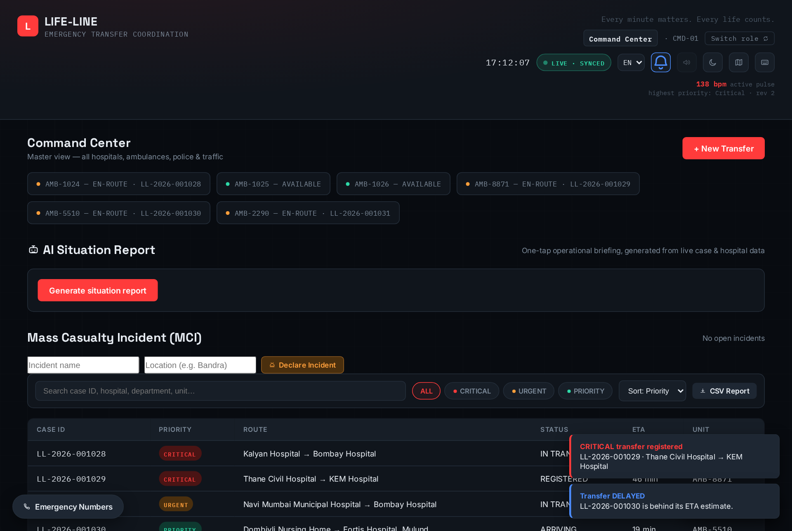
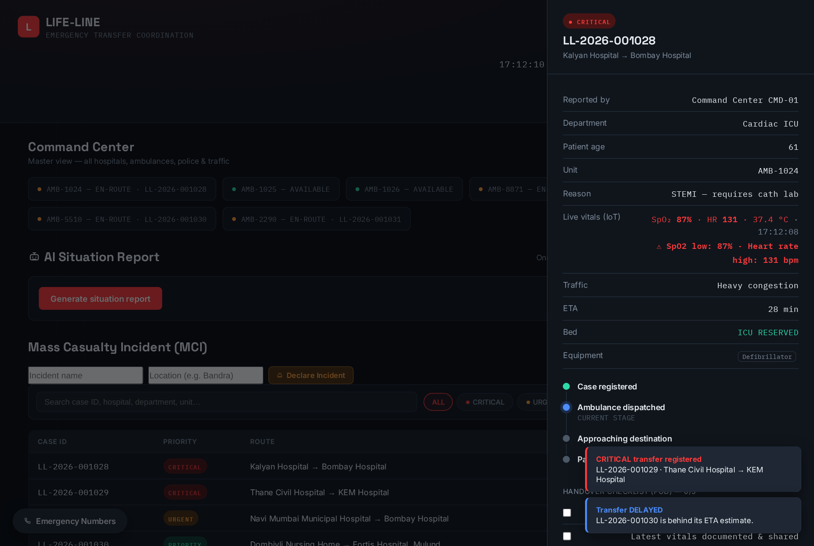
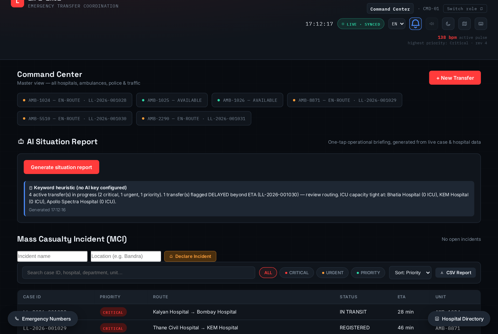
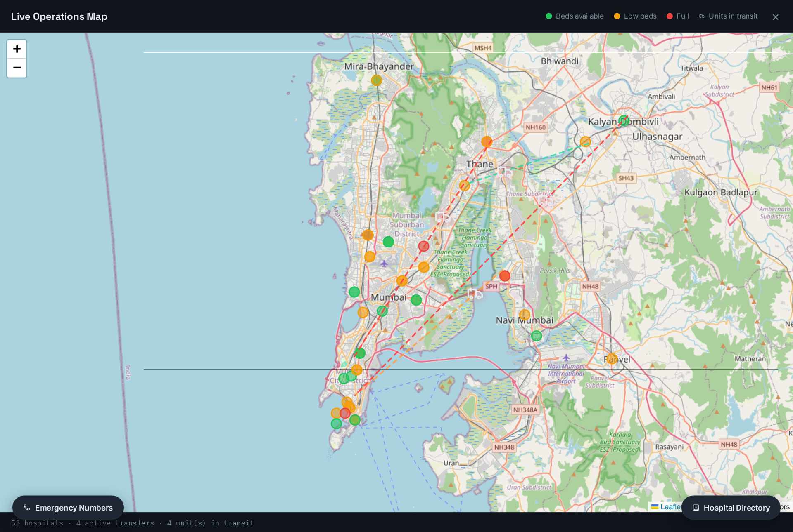
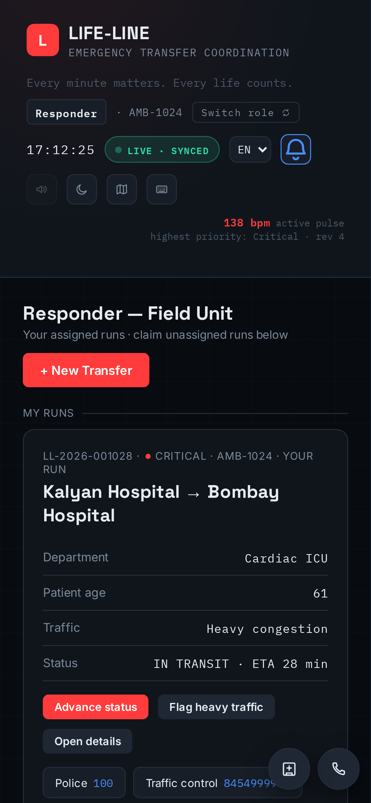
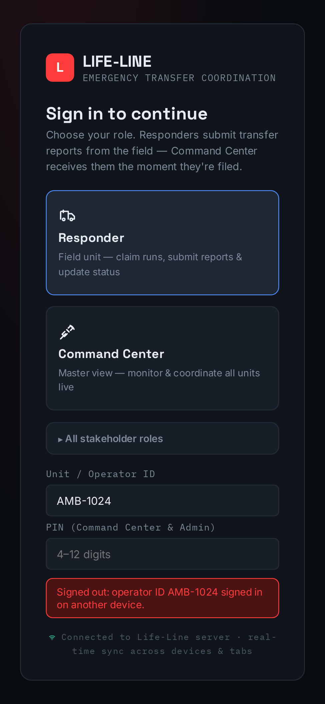

# Life-Line — Emergency Transfer Coordination

A live-synced coordination board for ambulance-to-hospital transfers, built as
a zero-dependency **Python (standard library) + vanilla JavaScript PWA** — no
pip install, no Node, no build step. v3.4 adds verified operator sign-in and a
**Raspberry Pi IoT kit** that streams GPS and patient vitals from the ambulance.

**Live demo (offline mode, mock data):** https://lifeline-five-omega.vercel.app/

## Why

In Indian metros, ambulance-to-hospital handoffs lose time in avoidable ways: a
responder calls a hospital that has no ICU bed, command hears about a delayed
transfer only when someone rings in, a mass-casualty scene has no shared picture
of who is headed where. Life-Line puts responders, sending/destination
hospitals, police, traffic control and command on one shared live state.

Two features are AI-assisted — triage suggestions and the situation report —
and both are honest about it. With `LIFELINE_GROQ_KEY` set they call a hosted
LLM through Groq; without it they fall back to an offline keyword heuristic and
say so (`"mode": "heuristic"`). Destination recommendation and ETA prediction
are plain rule-based scoring, always.

## Screenshots

| Command Center | Live vitals from the Pi kit |
|---|---|
|  |  |

| AI situation report | Live operations map |
|---|---|
|  |  |

| Responder on a phone | Same ID signed in elsewhere |
|---|---|
|  |  |

## Run it

Python 3.9+ and a browser. That is the whole dependency list.

```bash
git clone https://github.com/kukrejaagirish/lifeline.git
cd lifeline
python3 server.py --seed-demo      # Windows: start.bat
```

Open **http://127.0.0.1:8787**, type an operator ID and pick a role:

| Role | Operator ID | PIN |
|---|---|---|
| Responder (ambulance) | `AMB-1024` (also 1025, 1026, 8871, 5510, 2290) | — |
| Command Center | `CMD-01` | `1234` (demo — set `LIFELINE_DEMO_PIN`) |
| Admin | `ADMIN-001` | `1234` |
| Sending / Destination hospital | `SEND-01` / `DEST-01` | — |
| Patient attendant / Police / Traffic | `ATT-01` / `POL-01` / `TRF-01` | — |

Open it in a few tabs or on a phone on the same Wi-Fi (`http://<your-ip>:8787`,
start with `--host 0.0.0.0`) and watch every action sync live.

No Python handy? Open `public/index.html` directly — it detects the missing
server and runs an offline demo with mock data (this is what the Vercel link shows).

## Sign-in rules (v3.4)

* An operator ID is required. Letters, digits and dashes, up to 24 characters.
* **Same ID twice** → the new sign-in succeeds and the older session is signed
  out at once (its screen returns to sign-in with the reason). One active
  session per operator ID; `LIFELINE_SINGLE_SESSION=0` allows several.
* **Different IDs** → independent sessions.
* An ID keeps the role it was registered with: `AMB-1024` cannot sign in as Command Center.
* Command Center and Admin always need a PIN; 5 wrong PINs lock the ID for 5 minutes.
* Open demo mode (default) lets a brand-new non-privileged ID register itself on
  first sign-in. Set `LIFELINE_OPEN_LOGIN=0` so only admin-registered IDs work.
* Police, traffic control and patient attendants never receive clinical data
  (age, diagnosis, notes, vitals).

## IoT: Raspberry Pi ambulance kit

`iot/pi_agent.py` runs on a Raspberry Pi 4 in the ambulance (GPS, MAX30102
SpO₂/heart-rate sensor, DS18B20 temperature probe, PANIC and ARRIVED buttons,
optional RC522 RFID wristband reader) and posts a reading every 5 s:

```http
POST /api/iot/telemetry
X-Device-Key: <key from POST /api/iot/devices>

{"device_id": "PI-AMB-1024", "seq": 1729950000,
 "gps": {"lat": 19.03, "lng": 72.85, "speed_kmh": 44},
 "vitals": {"spo2": 88, "hr": 128, "temp_c": 37.6},
 "button": "none"}
```

| Answer | When |
|---|---|
| `202` `{"accepted": true, "case_id": …, "alerts": ["SpO2 low: 88%"], "actions": [], "next_interval_s": 5}` | valid reading |
| `400` `{"code": "bad_telemetry", "fields": {"gps.lat": "must be between -90 and 90", …}}` | impossible sensor values |
| `401` `{"code": "device_unauthorized"}` / `device_key_missing` | unknown device, wrong key, no key |
| `409` `{"code": "stale_seq"}` | replayed or out-of-order reading |
| `429` `{"code": "too_frequent"}` | faster than one reading per 0.5 s |

Vitals land on the ambulance's active case (shown live on the case screen),
abnormal values raise an alert to Command and the destination hospital, PANIC
raises the case to CRITICAL, and ARRIVED closes the run. No hardware? Use the simulator:

```bash
python3 iot/iot_simulator.py --scenario deteriorate --count 12 --interval 2
python3 iot/iot_simulator.py --scenario panic | arrive | bad-data | unknown-device
```

Wiring, parts list and systemd setup: `iot/pi_agent.py` header and `docs/DEPLOY.md`.

## Tests

```bash
python3 -m unittest discover -s tests -v
```

The suite boots the real server in a throw-away folder and drives it over HTTP:
sign-in rules, permissions, case lifecycle, validation, privacy, rate limits,
restart persistence, every IoT answer above and the simulator. CI runs it on
Python 3.9–3.12.

## CLI flags

```
python server.py [--host 127.0.0.1] [--port 8787] [--fresh] [--no-sim] [--seed-demo]
                 [--region mumbai] [--certfile FILE --keyfile FILE] [--logfile FILE]
```

`--fresh` wipes the database. `--no-sim` turns off the demo simulation (ETAs
counting down, traffic changes); the SLA watchdog keeps running. `--seed-demo`
puts four sample transfers on the board.

## Environment variables (`.env` next to `server.py`, real env vars win)

| Variable | Default | Meaning |
|---|---|---|
| `LIFELINE_OPEN_LOGIN` | `1` | `0` = only admin-registered operator IDs may sign in |
| `LIFELINE_SINGLE_SESSION` | `1` | one live session per operator ID |
| `LIFELINE_DEMO_PIN` | `1234` | PIN given to CMD-01 / ADMIN-001 on first boot — change it |
| `LIFELINE_DEMO_DEVICE_KEY` | `demo-pi-key-1024` | key of the demo Pi `PI-AMB-1024` |
| `LIFELINE_IOT_MIN_INTERVAL_S` | `0.5` | minimum gap between readings from one device |
| `LIFELINE_GROQ_KEY` / `LIFELINE_GROQ_MODEL` | — / `llama-3.3-70b-versatile` | AI triage and situation report |
| `LIFELINE_TWILIO_SID` / `_AUTH` / `_FROM` | — | real SMS/WhatsApp (sent in the background) |
| `LIFELINE_SLA_REGISTER_MIN` | `10` | minutes before a REGISTERED case auto-escalates |
| `LIFELINE_DELAY_GRACE_MIN` | `10` | grace past ETA before DELAYED |
| `LIFELINE_RATE_LIMIT` | `120` | POST requests per minute per IP |

## API

Bearer token from `POST /api/login` (`{"role", "unit", "pin"}`) on every route except health, login and IoT.

* Reads: `/api/health`, `/api/session`, `/api/state`, `/api/events` (SSE), `/api/hospitals`,
  `/api/audit`, `/api/notifications`, `/api/recommend`, `/api/predict`,
  `/api/situation-report`, `/api/report.csv`, `/api/iot/devices`.
* Writes: `/api/login`, `/api/logout`, `/api/users/register`, `/api/cases`,
  `/api/cases/{id}/status|claim|assign|dispatch|traffic|notes|cancel|escalate|handover`,
  `/api/triage`, `/api/incidents`, `/api/incidents/{id}/close`,
  `/api/iot/telemetry`, `/api/iot/devices`.
* Errors are `{"error": "…", "code": "…"}`: `401` means no live session
  (`sign_in_required`, `session_expired`, `session_replaced`, `signed_out`),
  `403` means the role may not do it.

## How it stays in sync

Every change bumps a revision, writes through to SQLite and pushes a snapshot
over Server-Sent Events, filtered by role. IoT readings travel as small
`telemetry` events between snapshots.

## Deploying

The Python server needs a host that keeps a process running (Render, Railway,
Fly.io, any VPS, or the Raspberry Pi itself). Static hosts such as Vercel can
only serve the offline demo. See `docs/DEPLOY.md`.

## Disclaimer

Demo/training software with mock Mumbai data — not a medical device and not for
real dispatch. Bed counts are simulated; SMS/WhatsApp is simulated unless Twilio
is configured. The pulse-oximeter maths in the Pi kit is illustrative only.
